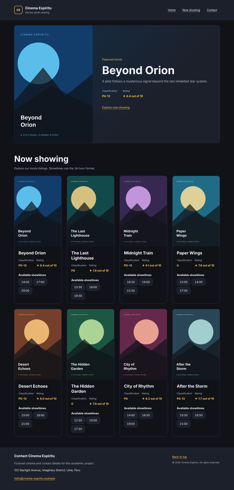

# Laboratorio 09 — Cinema Espiritu

Cartelera de cine hecha con React, JSX y Vite para el curso **Desarrollo de Aplicaciones Empresariales** (sección 4-C24-B). Muestra una película destacada y una cartelera de ocho películas con afiche, clasificación, valoración y horarios. Las películas, los afiches SVG y los datos de contacto son ficticios.

**Autor:** Sebastián Espíritu



## Requisitos

- Node.js 20 o superior (probado con Node v24.15.0 y npm 11.12.1)
- Git

## Instalación y ejecución

```powershell
npm install
npm run dev
```

Abrir la URL que muestra Vite (normalmente `http://localhost:5173/`). Detener con `Ctrl+C`.

Otros comandos:

| Comando | Qué hace |
| --- | --- |
| `npm run build` | Genera la versión de producción en `dist/` |
| `npm run preview` | Sirve localmente la carpeta `dist/` |
| `npm run lint` | Revisa el código con Oxlint |

## Dependencias

Declaradas en `package.json` y fijadas en `package-lock.json`:

| Paquete | Uso |
| --- | --- |
| `react`, `react-dom` | Biblioteca de interfaz y renderizado en el navegador |
| `vite`, `@vitejs/plugin-react` | Servidor de desarrollo y compilación con soporte JSX |
| `oxlint` | Linter |
| `@types/react`, `@types/react-dom` | Tipos para el autocompletado del editor |

`.gitignore` excluye `node_modules/` y `dist/`.

## Estructura del proyecto

```text
public/
  favicon.svg
  images/movies/          Ocho afiches SVG
src/
  components/
    Header/Header.jsx       Marca del cine y navegación
    Hero/Hero.jsx           Banner de la película destacada
    MovieList/MovieList.jsx Cartelera: recorre las películas con map
    MovieCard/MovieCard.jsx Tarjeta de una película
    Footer/Footer.jsx       Contacto e información
  data/movies.js          Datos de las ocho películas
  styles/                 Arquitectura CSS (ver abajo)
  App.jsx                 Composición de la página
  main.jsx                Punto de entrada
docs/
  INFORME-LAB09.md        Informe del laboratorio con capturas
  lab09-checklist.md      Cumplimiento de los 12 pasos y la rúbrica
  evidence/
    jsx-errors.md         Los tres errores JSX provocados y su solución
    screenshots/          Capturas de la aplicación
```

## Componentes y props


| Componente | Responsabilidad | Props que recibe |
| --- | --- | --- |
| `App` | Importa los datos, elige la película destacada y compone la página | — |
| `Header` | Nombre del cine y navegación | — |
| `Hero` | Banner con afiche, título, sinopsis, clasificación y valoración | `movie` |
| `MovieList` | Título de la sección y cuadrícula de tarjetas | `movies` |
| `MovieCard` | Afiche, título, clasificación, valoración y horarios | `movie` |
| `Footer` | Datos de contacto y derechos | — |

Flujo de datos: `App` es el único componente que importa `movies.js`. Pasa `movies[0]` a `Hero` y el arreglo completo a `MovieList`, que lo recorre con `map` y crea un `MovieCard` por película:

```jsx
{movies.map((movie) => (
  <MovieCard key={movie.id} movie={movie} />
))}
```

Los componentes hijos no saben de dónde vienen los datos; solo usan lo que reciben por props. La `key` usa el `id` de cada película (nunca el índice), y los horarios usan `${id}-${showtime}`.

## Datos

Cada película de `src/data/movies.js` tiene `id`, `title`, `image`, `synopsis`, `classification`, `rating` (escala 0–10, se muestra con un decimal) y `showtimes` (formato 24 horas). Las imágenes usan `import.meta.env.BASE_URL` para que funcionen también tras compilar.

## Arquitectura CSS

`src/styles/index.css` es la única hoja que se importa (en `main.jsx`) y reúne el resto en orden:

| Archivo | Contenido |
| --- | --- |
| `variables.css` | Colores, tipografía, espaciados y radios |
| `base.css` | Reglas globales y foco visible |
| `layout.css` | Contenedor y distribución general |
| `header.css`, `hero.css`, `movie-list.css`, `movie-card.css`, `footer.css` | Estilos de cada componente |

La cuadrícula usa `repeat(auto-fit, minmax(...))`, así que pasa de cuatro columnas en escritorio a una en el celular.

## Errores típicos de JSX

Se provocaron y corrigieron tres errores (detalle en [docs/evidence/jsx-errors.md](docs/evidence/jsx-errors.md)):

| Error | Mensaje | Solución |
| --- | --- | --- |
| `class` en vez de `className` | Invalid DOM property `class`. Did you mean `className`? | Usar `className` |
| Dos nodos raíz | Adjacent JSX elements must be wrapped in an enclosing tag. | Un solo contenedor o un fragmento `<>...</>` |
| `map` sin `key` | Each child in a list should have a unique "key" prop. | `key={movie.id}` |

## Pruebas

| Prueba | Resultado |
| --- | --- |
| `npm run build` | Compila sin errores |
| `npm run lint` | Sin advertencias ni errores |
| Página en el navegador | Header, Hero, 8 tarjetas, 24 horarios y Footer; consola sin errores |
| Datos | Cada tarjeta coincide con su registro de `movies.js` |
| Afiches | Los 8 SVG cargan correctamente |
| Celular (390 px) | Una columna, sin desplazamiento horizontal |
| Teclado | `Tab` muestra el enlace "Skip to content" y el foco es visible |

Más detalle en el [informe](docs/INFORME-LAB09.md).
