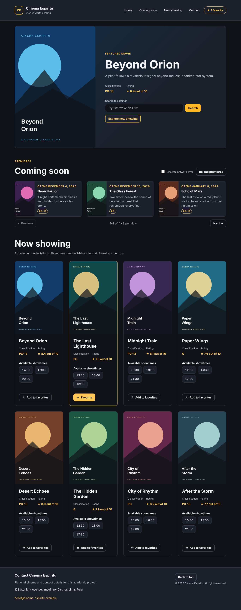
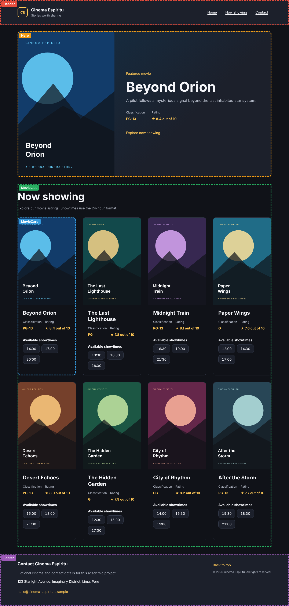
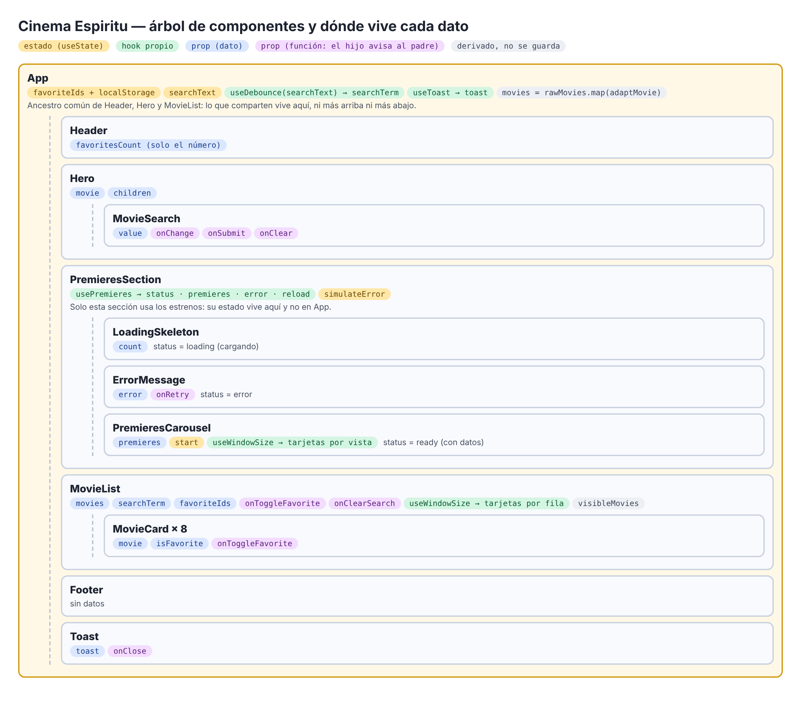
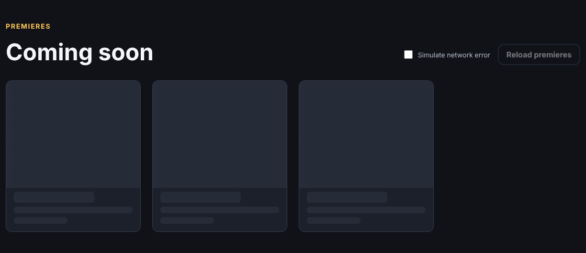
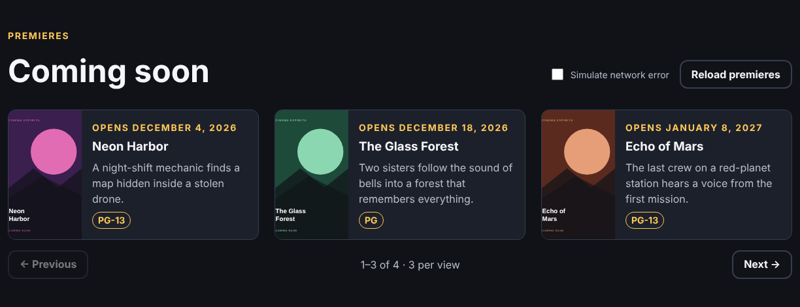
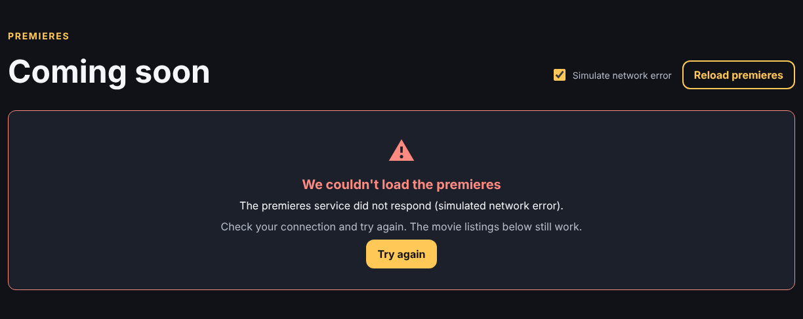
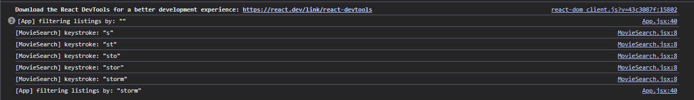
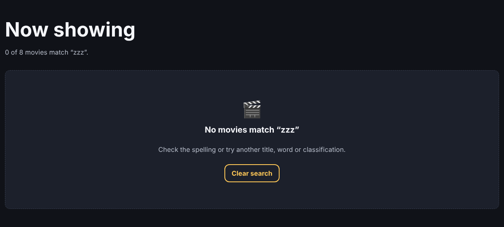

# Cinema Espiritu — Laboratorios 09, 10 y 11

Cartelera de cine hecha con React, JSX y Vite para el curso **Desarrollo de Aplicaciones Empresariales** (sección 4-C24-B). El proyecto es acumulativo: el **Lab 09** armó la cartelera con componentes y props; el **Lab 10** le agrega un botón reutilizable, favoritas que se guardan en el navegador y un buscador con retardo; el **Lab 11** (rama `lab11`) añade comunicación entre componentes hermanos, hooks propios, un adaptador de datos, avisos emergentes y una sección de estrenos con estados de carga y de error. Las películas, los afiches SVG y los datos de contacto son ficticios.

**Autor:** Sebastián Espíritu



## Requisitos

- Node.js 20 o superior (probado con Node v24.15.0 y npm 11.12.1)
- Git

## Instalación y ejecución

```powershell
npm install
npm run dev
```

Abrir la URL que muestra Vite (normalmente `http://localhost:5173/`). Detener con `Ctrl+C`.

Otros comandos:

| Comando | Qué hace |
| --- | --- |
| `npm run build` | Genera la versión de producción en `dist/` |
| `npm run preview` | Sirve localmente la carpeta `dist/` |
| `npm run lint` | Revisa el código con Oxlint |

## Dependencias

Declaradas en `package.json` y fijadas en `package-lock.json`:

| Paquete | Uso |
| --- | --- |
| `react`, `react-dom` | Biblioteca de interfaz y renderizado en el navegador |
| `vite`, `@vitejs/plugin-react` | Servidor de desarrollo y compilación con soporte JSX |
| `oxlint` | Linter |
| `@types/react`, `@types/react-dom` | Tipos para el autocompletado del editor |

`.gitignore` excluye `node_modules/` y `dist/`.

## Estructura del proyecto

```text
public/
  favicon.svg
  images/movies/          Ocho afiches SVG
src/
  components/
    Button/Button.jsx           Botón reutilizable con variantes (Lab 10)
    ErrorMessage/               Mensaje de error con botón para reintentar (Lab 11)
    LoadingSkeleton/            Esqueleto de carga (Lab 11)
    PremieresCarousel/          Carrusel de estrenos (Lab 11)
    PremieresSection/           Sección de estrenos con sus tres estados (Lab 11)
    Toast/                      Aviso emergente (Lab 11)
    Header/Header.jsx           Marca, navegación y contador de favoritas
    Hero/Hero.jsx               Banner destacado; recibe el buscador por children
    MovieSearch/MovieSearch.jsx Buscador controlado (Lab 10)
    MovieList/MovieList.jsx     Filtra y dibuja la cartelera; estado vacío
    MovieCard/MovieCard.jsx     Tarjeta con botón de favorita
    Footer/Footer.jsx           Contacto e información
  hooks/
    useDebounce.js        Retardo (buscador y tamaño de ventana)
    useWindowSize.js      Tamaño de la ventana (Lab 11)
    usePremieres.js       Petición de estrenos: cargando, con datos o error (Lab 11)
    useToast.js           Aviso que se oculta solo (Lab 11)
  lib/
    adaptMovie.js         Patrón adaptador: datos crudos → modelo de la app (Lab 11)
    api.js                Petición simulada con retardo y modo de fallo (Lab 11)
  data/
    movies.js             Cartelera en formato crudo de API
    premieres.js          Estrenos en formato crudo de API (Lab 11)
  styles/                 Arquitectura CSS (ver abajo)
  App.jsx                 Composición de la página
  main.jsx                Punto de entrada
docs/
  INFORME-LAB09.md        Informe del Lab 09
  INFORME-LAB10.md        Informe del Lab 10
  INFORME-LAB11.md        Informe del Lab 11
  lab09-checklist.md      Cumplimiento del Lab 09
  lab10-checklist.md      Cumplimiento del Lab 10
  lab11-checklist.md      Cumplimiento del Lab 11
  evidence/
    jsx-errors.md         Errores JSX del Lab 09
    screenshots/          Capturas del Lab 09
    lab10/                Capturas del Lab 10
    lab11/                Capturas del Lab 11
```

## Componentes y props



| Componente | Responsabilidad | Props o datos |
| --- | --- | --- |
| `App` | Adapta los datos, guarda lo compartido (favoritas, búsqueda, aviso) y compone la página | — |
| `Header` | Nombre del cine, navegación y contador de favoritas | `favoritesCount` |
| `Hero` | Banner de la película destacada con el buscador | `movie`, `children` |
| `MovieSearch` | Buscador controlado con botones Search y Clear | `value`, `onChange`, `onSubmit`, `onClear` |
| `PremieresSection` | Estrenos con sus estados de carga, error y datos | usa `usePremieres` |
| `LoadingSkeleton` | Tarjetas grises mientras carga | `count`, `label` |
| `ErrorMessage` | Explica el error y permite reintentar | `title`, `error`, `onRetry` |
| `PremieresCarousel` | Carrusel con anterior/siguiente | `premieres`; usa `useWindowSize` |
| `MovieList` | Filtra la cartelera y la dibuja en columnas según el ancho | `movies`, `searchTerm`, `favoriteIds`, `onToggleFavorite`, `onClearSearch`; usa `useWindowSize` |
| `MovieCard` | Tarjeta con botón de favorita | `movie`, `isFavorite`, `onToggleFavorite` |
| `Toast` | Aviso emergente | `toast`, `onClose` |
| `Button` | Botón o enlace con variante | `children`, `variant`, `href` y cualquier atributo |
| `Footer` | Datos de contacto y derechos | — |

Flujo de datos: `App` es el único componente que importa `movies.js`. Pasa `movies[0]` a `Hero` y el arreglo completo a `MovieList`, que lo filtra, lo recorre con `map` y crea un `MovieCard` por película:

```jsx
{visibleMovies.map((movie) => (
  <MovieCard
    key={movie.id}
    movie={movie}
    isFavorite={favoriteIds.includes(movie.id)}
    onToggleFavorite={onToggleFavorite}
  />
))}
```

Los componentes hijos no saben de dónde vienen los datos; solo usan lo que reciben por props. La `key` usa el `id` de cada película (nunca el índice), y los horarios usan `${id}-${showtime}`.

## Datos

`src/data/movies.js` y `src/data/premieres.js` guardan los registros como los enviaría una API: `movie_id`, `name`, `poster_file`, `overview`, `age_rating`, `score` (0–100) y `show_times` (texto con horas en formato 24 h); los estrenos añaden `release_date`. `adaptMovie()` los convierte al modelo que usan los componentes: `id`, `title`, `image`, `synopsis`, `classification`, `rating` (0–10, o `null` si no hay), `showtimes` (arreglo ordenado) y `releaseDate`.

## Arquitectura CSS

`src/styles/index.css` es la única hoja que se importa (en `main.jsx`) y reúne el resto en orden:

| Archivo | Contenido |
| --- | --- |
| `variables.css` | Colores, tipografía, espaciados, alto de controles y transiciones |
| `base.css` | Reglas globales, tipografía y foco visible |
| `utilities.css` | Clases de utilidad (`visually-hidden`, `stack`, `cluster`, `text-center`) |
| `forms.css` | Etiquetas, campos de texto y buscador |
| `layout.css` | Contenedor y distribución general |
| `typography.css` | Escala tipográfica: etiquetas de sección, títulos, texto pequeño (Lab 11) |
| `button.css` | Componente Button y sus tres variantes |
| `premieres.css` | Estrenos: esqueleto de carga, mensaje de error y carrusel (Lab 11) |
| `toast.css` | Aviso emergente (Lab 11) |
| `header.css`, `hero.css`, `movie-list.css`, `movie-card.css`, `footer.css` | Estilos de cada componente |

La cuadrícula usa `repeat(auto-fit, minmax(...))`, así que pasa de cuatro columnas en escritorio a una en el celular.

## Lab 11: comunicación entre componentes y hooks propios

El trabajo de este laboratorio está en la rama **`lab11`**.



### Estado elevado al ancestro común

| Dato | Dónde vive | Quién lo usa | Por qué ahí |
| --- | --- | --- | --- |
| Favoritas (`favoriteIds`) | `App` | `Header` (contador) y `MovieList` → `MovieCard` | `Header` y `MovieList` son hermanos; su ancestro común más cercano es `App`. |
| Texto del buscador (`searchText`) | `App` | `MovieSearch` (dentro de `Hero`) y `MovieList` | `Hero` y `MovieList` son hermanos. |
| Aviso (`toast`) | `App` (`useToast`) | `Toast` | Lo dispara el cambio de favoritas, que ocurre en `App`. |
| Estrenos (`status`, `premieres`, `error`) | `PremieresSection` (`usePremieres`) | Solo esa sección | Nadie más los usa: no se suben a `App`. |
| Simular error | `PremieresSection` | Solo esa sección | Igual que arriba. |
| Posición del carrusel (`start`) | `PremieresCarousel` | Solo el carrusel | Estado local. |

**Por qué el contador de favoritas no puede vivir en `Header`.** Las favoritas cambian cuando se pulsa el botón de una `MovieCard`, que está dentro de `MovieList`. `Header` y `MovieList` son hermanos, y en React los datos solo bajan de padre a hijo: un hermano no puede leer ni cambiar el estado de otro. Si el contador viviera en `Header`, las tarjetas no tendrían forma de actualizarlo. Por eso las favoritas viven en `App`, el ancestro común más cercano. `App` le pasa a `Header` solo el número (`favoriteIds.length`), no la lista, porque la cabecera no necesita más.

### Hooks propios: qué lógica se extrajo y quién la comparte

| Hook | Lógica que encapsula | Dónde se usa |
| --- | --- | --- |
| `useDebounce` | Esperar a que un valor deje de cambiar | `App` (buscador) y dentro de `useWindowSize` → llega a `MovieList` y `PremieresCarousel` |
| `useWindowSize` | Leer el ancho de la ventana y escuchar `resize` (con limpieza) | `MovieList` (tarjetas por fila) y `PremieresCarousel` (tarjetas por vista) |
| `usePremieres` | Petición con tres estados, `reload()` e ignorar respuestas viejas | `PremieresSection` |
| `useToast` | Mostrar un aviso que se oculta solo tras 3 s | `App` |

Sin estos hooks, la lógica de escuchar el tamaño de la ventana y la del temporizador se repetiría en cada componente que la usa.

### Patrón adaptador

Los datos llegan en formato de API (`movie_id`, `name`, `poster_file`, `score` de 0 a 100, `show_times` como texto). `adaptMovie()` los convierte al modelo de la app (`id`, `title`, `image`, `rating` de 0 a 10, `showtimes` ordenados) y pone valores por defecto si falta algo. La cartelera y los estrenos pasan por el mismo adaptador, así que los componentes nunca leen los nombres crudos.

### Estados de carga y de error

`usePremieres` simula la petición con `fetchPremieres()` (1,5 s de retardo). Mientras carga se muestra el esqueleto; con datos, el carrusel; si falla, un mensaje que explica el error y un botón **Try again**. Para ver el error: marcar **Simulate network error** y pulsar **Reload premieres**, o abrir `http://localhost:5173/?fail=1`.

| Cargando | Con datos | Error |
| --- | --- | --- |
|  |  |  |

### Aviso emergente y botón Clear

`MovieCard` solo llama a `onToggleFavorite(id)`; no sabe que existe un aviso. `App` cambia las favoritas y llama a `showToast()`.

El botón **Clear** del banner llama a `onClear()`. `App` vacía `searchText` y el filtro se aplica al instante, sin esperar el retardo, así que el campo y la cartelera quedan sincronizados.

Detalle en el [informe del Lab 11](docs/INFORME-LAB11.md).

## Lab 10: componentes reutilizables, estado y eventos

### Componentes reutilizables

| Componente | Por qué es reutilizable | Dónde se usa |
| --- | --- | --- |
| `Button` | Recibe el texto por `children` y el aspecto por `variant` (`primary`, `secondary`, `ghost`). Si recibe `href` se dibuja como enlace; si no, como `<button>`. Pasa el resto de props (`onClick`, `aria-pressed`, `type`...) al elemento. | Buscar (Hero), Explore now showing (Hero), favorita de cada tarjeta, Clear search (estado vacío) y Back to top (Footer) |
| `MovieCard` | Solo depende de sus props `movie`, `isFavorite` y `onToggleFavorite`. | 8 veces en `MovieList` |
| `Hero` | Recibe por `children` lo que va dentro del banner; aquí, el buscador. | `App` |
| `MovieSearch` | Es una entrada controlada: el padre le da `value`, `onChange` y `onSubmit`. | Dentro de `Hero` |
| `useDebounce` | Hook genérico que retrasa cualquier valor. | El texto del buscador en `App` |

### Dónde vive cada dato que la app recuerda

| Dato | Dónde vive | Por qué ahí |
| --- | --- | --- |
| `favoriteIds` (favoritas) | Estado de `App` con `useState` | Lo usan el `Header` (contador) y cada `MovieCard` (botón). Por eso va en el padre común. Las tarjetas no lo modifican: llaman a `onToggleFavorite(id)` y `App` actualiza la lista. |
| Favoritas guardadas | `localStorage`, clave `cinema-espiritu:favorites` | `App` las lee al iniciar (`useState(readStoredFavorites)`) y las guarda con `useEffect` cada vez que cambian, así sobreviven a una recarga. |
| `searchText` (lo que se escribe) | Estado de `App` | Se escribe en `MovieSearch` (dentro de `Hero`), pero lo necesita `MovieList` y el botón "Clear search" del estado vacío lo borra. Si viviera en `MovieSearch`, `MovieList` no podría limpiarlo. |
| `searchTerm` (texto con retardo) | `useDebounce(searchText, 400)` en `App` | Solo cambia cuando el usuario deja de escribir 400 ms; es el que usa el filtro. |
| Películas visibles | No es estado: se calculan en `MovieList` en cada render | Salen de `movies` + `searchTerm`; guardarlas en estado duplicaría datos. |
| `isFavorite` de cada tarjeta | No es estado: `favoriteIds.includes(movie.id)` | Se deriva de las favoritas. |

El texto del buscador no se guarda en `localStorage` porque es temporal: al volver a la página se espera ver toda la cartelera.

### Comunicación hijo → padre

- `MovieCard` → `App`: `onToggleFavorite(movie.id)` al hacer clic en ☆/★.
- `MovieSearch` → `App`: `onChange(texto)` en cada pulsación y `onSubmit()` al pulsar Search.
- `MovieList` → `App`: `onClearSearch()` desde el estado vacío.

### Retardo del buscador

Al escribir "storm" la consola muestra cinco pulsaciones y un solo filtrado:

```text
[MovieSearch] keystroke: "s"
[MovieSearch] keystroke: "st"
[MovieSearch] keystroke: "sto"
[MovieSearch] keystroke: "stor"
[MovieSearch] keystroke: "storm"
[App] filtering listings by: "storm"
```



### Estado vacío



Detalle completo en el [informe del Lab 10](docs/INFORME-LAB10.md).

## Errores típicos de JSX (Lab 09)

Se provocaron y corrigieron tres errores (detalle en [docs/evidence/jsx-errors.md](docs/evidence/jsx-errors.md)):

| Error | Mensaje | Solución |
| --- | --- | --- |
| `class` en vez de `className` | Invalid DOM property `class`. Did you mean `className`? | Usar `className` |
| Dos nodos raíz | Adjacent JSX elements must be wrapped in an enclosing tag. | Un solo contenedor o un fragmento `<>...</>` |
| `map` sin `key` | Each child in a list should have a unique "key" prop. | `key={movie.id}` |

## Pruebas

| Prueba | Resultado |
| --- | --- |
| `npm run build` | Compila sin errores |
| `npm run lint` | Sin advertencias ni errores |
| Página en el navegador | Header, Hero, 8 tarjetas, 24 horarios y Footer; consola sin errores |
| Favoritas | El botón cambia a ★ Favorite, el contador del Header sube y baja, y siguen tras recargar |
| Buscador | "storm" → 1 película; "pg-13" → 4; "zzz" → estado vacío; Clear search vuelve a 8 |
| Retardo | 5 pulsaciones → 1 filtrado |
| Estrenos | Esqueleto mientras carga, carrusel con 4 estrenos, error con Try again, `?fail=1` |
| Columnas | 4 por fila a 1366 px, 3 a 1024 px, 2 a 768 px, 1 a 390 px |
| Aviso | Aparece al marcar y desmarcar, y se oculta a los 3 s |
| Clear | Vacía el campo y muestra las 8 películas al instante |
| Datos | Cada tarjeta coincide con su registro de `movies.js` |
| Afiches | Los 8 SVG cargan correctamente |
| Celular (390 px) | Una columna, sin desplazamiento horizontal |
| Teclado | `Tab` muestra el enlace "Skip to content" y el foco es visible |

Más detalle en el [informe](docs/INFORME-LAB09.md).
