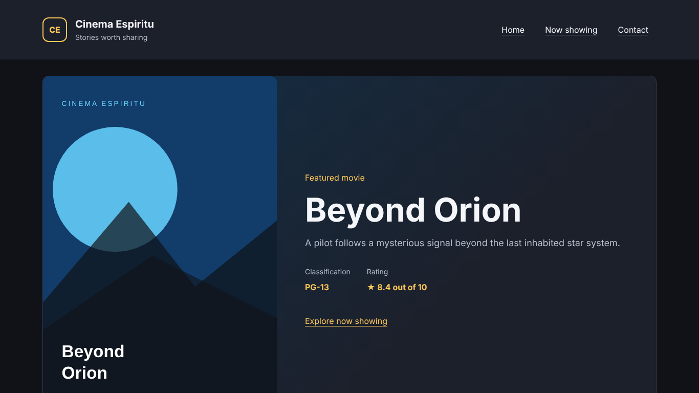
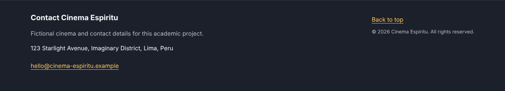
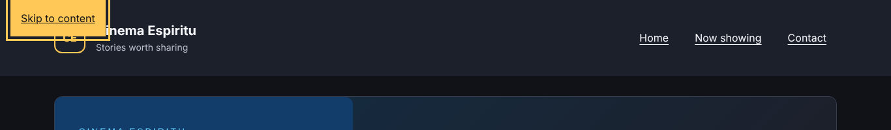
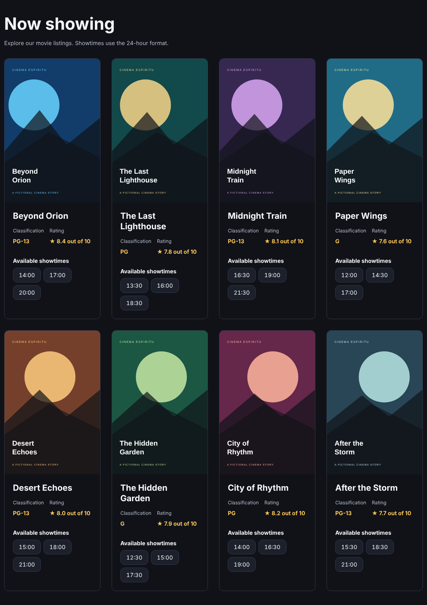
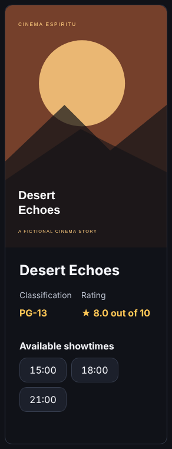
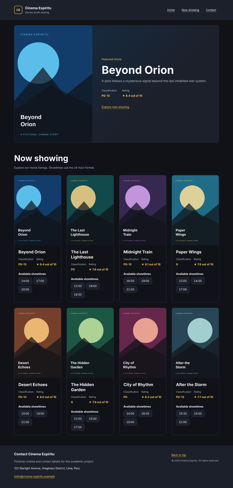
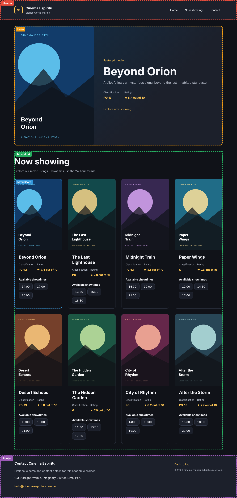
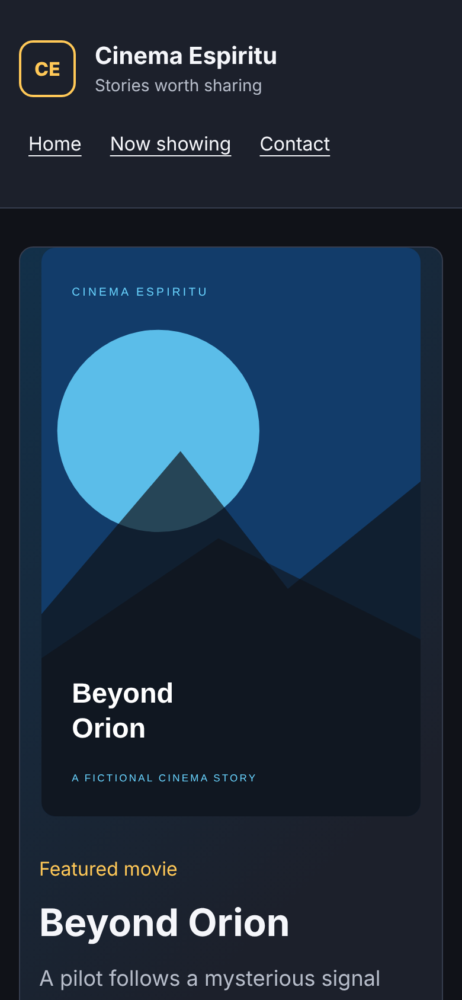

# Informe — Laboratorio 09: ReactJS

## 1. Datos generales

| Campo | Información |
| --- | --- |
| Curso | Desarrollo de Aplicaciones Empresariales |
| Sección | 4-C24-B |
| Docente | Michael Montgomery Rosell |
| Alumno | Sebastián Espíritu |
| Proyecto | Cinema Espiritu: cartelera con React y Vite |
| Repositorio | https://github.com/SebastianEspiritu/lab09-react-cine-espiritu |

## 2. Capacidades trabajadas

- Crear un proyecto de React con Vite y levantarlo en el servidor de desarrollo.
- Escribir componentes funcionales con JSX y componerlos en una interfaz completa.
- Pasar datos de un componente padre a sus hijos mediante props.

## 3. Fundamento aplicado

JSX permite describir la interfaz dentro de funciones de JavaScript. Cada componente tiene una sola responsabilidad y vive en su propia carpeta, con nombre en PascalCase. `App` es el único que conoce el archivo de datos: entrega a `Hero` una película y a `MovieList` el arreglo completo. `MovieList` recorre el arreglo con `map` y entrega cada película a un `MovieCard`, identificándola con `key={movie.id}`. Así los hijos no saben de dónde salen los datos y se pueden reutilizar.

## 4. Desarrollo

Todos los desarrollos fueron realizados por **Sebastián Espíritu**.

### 4.1. Creación del proyecto con Vite

**Alumno:** Sebastián Espíritu

```powershell
node --version
npm create vite@latest . -- --template react
npm install
npm run dev
```

Se comprobó Node v24.15.0 (la guía pide 20 o superior), se creó el proyecto con la plantilla de React, se instalaron las dependencias y se levantó el servidor de desarrollo de Vite en `http://localhost:5173/`. Después se limpió la plantilla: se quitaron el contador, los logos y los estilos de demostración, y quedaron `index.html`, `src/main.jsx` y `src/App.jsx` con lo mínimo.

**Figura 1. Terminal con `node --version` y `npm run dev` en marcha.**
> Insertar aquí la captura de la terminal: `docs/evidence/screenshots/01-environment-dev.png`

**Caso de prueba:** abrir la URL que muestra Vite → la página carga sin errores en la consola.

### 4.2. Datos y arquitectura CSS

**Alumno:** Sebastián Espíritu

`src/data/movies.js` exporta ocho películas con `id`, `title`, `image`, `synopsis`, `classification`, `rating` y `showtimes`:

```js
{
  id: 'beyond-orion',
  title: 'Beyond Orion',
  image: `${import.meta.env.BASE_URL}images/movies/beyond-orion.svg`,
  synopsis: 'A pilot follows a mysterious signal beyond the last inhabited star system.',
  classification: 'PG-13',
  rating: 8.4,
  showtimes: ['14:00', '17:00', '20:00'],
}
```

| Película | Clasificación | Valoración | Horarios |
| --- | --- | --- | --- |
| Beyond Orion | PG-13 | 8.4 | 14:00, 17:00, 20:00 |
| The Last Lighthouse | PG | 7.8 | 13:30, 16:00, 18:30 |
| Midnight Train | PG-13 | 8.1 | 16:30, 19:00, 21:30 |
| Paper Wings | G | 7.6 | 12:00, 14:30, 17:00 |
| Desert Echoes | PG-13 | 8.0 | 15:00, 18:00, 21:00 |
| The Hidden Garden | G | 7.9 | 12:30, 15:00, 17:30 |
| City of Rhythm | PG | 8.2 | 14:00, 16:30, 19:00 |
| After the Storm | PG-13 | 7.7 | 15:30, 18:30, 21:00 |

Los estilos están en `src/styles/`: `index.css` importa `variables.css` (colores, tipografía y espaciado), `base.css`, `layout.css` y una hoja por componente.

**Caso de prueba:** cada tarjeta de la página coincide con su registro; los ocho afiches cargan.

### 4.3. Header y Footer

**Alumno:** Sebastián Espíritu

```jsx
function Header() {
  return (
    <header className="site-header" id="home">
      <a className="skip-link" href="#main-content">Skip to content</a>
      <div className="container header-content">
        <a className="brand" href="#home" aria-label="Cinema Espiritu home">
          <span className="brand-mark" aria-hidden="true">CE</span>
          <span>
            <strong className="brand-name">Cinema Espiritu</strong>
            <span className="brand-tagline">Stories worth sharing</span>
          </span>
        </a>
        <nav aria-label="Main navigation">
          <ul className="navigation-links">
            <li><a href="#home">Home</a></li>
            <li><a href="#now-showing">Now showing</a></li>
            <li><a href="#contact">Contact</a></li>
          </ul>
        </nav>
      </div>
    </header>
  )
}
```

El Header muestra el nombre del cine y la navegación a las secciones de la página. El Footer muestra dirección, correo, enlace para volver arriba y el año actual, calculado con `new Date().getFullYear()`.





**Casos de prueba:** los enlaces Home, Now showing y Contact llevan a su sección. Al pulsar `Tab` aparece el enlace "Skip to content" (figura 4).



### 4.4. Hero con props

**Alumno:** Sebastián Espíritu

```jsx
// App.jsx
const featuredMovie = movies[0]
<Hero movie={featuredMovie} />

// Hero.jsx
function Hero({ movie }) {
  const { image, title, synopsis, classification, rating } = movie
  // ...
  <h1 id="featured-movie-title">{title}</h1>
  <p className="hero-synopsis">{synopsis}</p>
  <dd>{rating.toFixed(1)} out of 10</dd>
}
```

`Hero` no importa los datos: recibe la película por la prop `movie` y la desestructura. En la figura 2 se ve Beyond Orion como película destacada.

**Caso de prueba:** cambiar `movies[0]` por `movies[1]` en App → el banner muestra The Last Lighthouse sin tocar `Hero.jsx`.

### 4.5. MovieCard y MovieList

**Alumno:** Sebastián Espíritu

```jsx
// MovieList.jsx
function MovieList({ movies }) {
  return (
    <section className="movie-list" id="now-showing">
      <h2>Now showing</h2>
      <div className="movie-grid">
        {movies.map((movie) => (
          <MovieCard key={movie.id} movie={movie} />
        ))}
      </div>
    </section>
  )
}

// MovieCard.jsx (horarios)
{showtimes.map((showtime) => (
  <li key={`${id}-${showtime}`}>
    <time dateTime={showtime}>{showtime}</time>
  </li>
))}
```

`MovieList` recorre la cartelera con `map` y dibuja una tarjeta por película, pasando `key={movie.id}`. `MovieCard` recibe una película y muestra afiche, título, clasificación, valoración y horarios.





**Casos de prueba:** se dibujan 8 tarjetas y 24 horarios (3 por película), todos iguales a `movies.js`. Desert Echoes muestra "8.0 out of 10".

### 4.6. Composición en App y diseño adaptable

**Alumno:** Sebastián Espíritu

```jsx
function App() {
  const featuredMovie = movies[0]

  return (
    <>
      <Header />
      <main className="container main-content" id="main-content" tabIndex={-1}>
        <Hero movie={featuredMovie} />
        <MovieList movies={movies} />
      </main>
      <Footer />
    </>
  )
}
```

`App` usa un fragmento para devolver un solo nodo raíz y compone los cinco componentes. La figura 7 muestra la página completa y la figura 8 marca qué parte dibuja cada componente.







**Casos de prueba:** en escritorio la cuadrícula tiene cuatro columnas; en 390 px pasa a una columna y no hay desplazamiento horizontal. La consola del navegador queda sin errores.

### 4.7. Estructura del proyecto

**Alumno:** Sebastián Espíritu

```text
src/
  components/
    Header/Header.jsx
    Hero/Hero.jsx
    MovieList/MovieList.jsx
    MovieCard/MovieCard.jsx
    Footer/Footer.jsx
  data/movies.js
  styles/ (index, variables, base, layout, header, hero, movie-list, movie-card, footer)
  App.jsx
  main.jsx
```

**Figura 10. Estructura del proyecto en Visual Studio Code.**
> Insertar aquí la captura del explorador de VS Code con las carpetas abiertas: `docs/evidence/screenshots/07-project-tree.png`

### 4.8. Errores típicos de JSX

**Alumno:** Sebastián Espíritu

Se provocó cada error por separado en `MovieList.jsx` y se restauró el código antes del siguiente. El registro completo está en [evidence/jsx-errors.md](evidence/jsx-errors.md).

| Error provocado | Mensaje | Tipo | Solución |
| --- | --- | --- | --- |
| `<section class="movie-list">` | Invalid DOM property `class`. Did you mean `className`? | Error de React en consola; la página se ve | `className` |
| `</section>` seguido de `<p>` | Adjacent JSX elements must be wrapped in an enclosing tag. | Error de compilación; la página no se genera | Un contenedor o `<>...</>` |
| `<MovieCard movie={movie} />` | Each child in a list should have a unique "key" prop. | Error de React en consola; la página se ve | `key={movie.id}` |

**Figura 11. Mensaje de uno de los errores en la consola o terminal.**
> Insertar aquí la captura: `docs/evidence/screenshots/09-jsx-errors.png`

### 4.9. Validación final

```powershell
npm run build
npm run lint
```

**Figura 12. Ejecución de `npm run build` y `npm run lint`.**
> Insertar aquí la captura de la terminal: `docs/evidence/screenshots/10-final-checks.png`

## 5. Casos de prueba

| N.º | Prueba | Resultado esperado | Resultado obtenido |
| --- | --- | --- | --- |
| P01 | `npm run dev` y abrir la URL | La página carga | Correcto |
| P02 | `npm run build` | Compila sin errores | Correcto |
| P03 | `npm run lint` | Sin advertencias | Correcto |
| P04 | Contar tarjetas | 8 | 8 |
| P05 | Contar horarios | 24 (3 por película) | 24 |
| P06 | Comparar tarjetas con `movies.js` | Datos iguales | Iguales |
| P07 | Valoración de Desert Echoes | 8.0 out of 10 | 8.0 out of 10 |
| P08 | Cargar los 8 afiches | Todos visibles | Todos visibles |
| P09 | Enlaces del Header | Llevan a su sección | Correcto |
| P10 | `Tab` al cargar | Aparece "Skip to content" con foco visible | Correcto |
| P11 | Vista a 390 px | Una columna, sin scroll horizontal | Correcto |
| P12 | Consola del navegador | Sin errores ni advertencias | Sin errores |
| P13 | Los tres errores JSX | Mensaje de React o del compilador | Ver sección 4.8 |

## 6. Observaciones

- Se aplicó la norma "una carpeta por componente": cada componente está en `src/components/<Nombre>/<Nombre>.jsx`.
- La valoración se muestra con `rating.toFixed(1)` para que todas tengan un decimal (antes Desert Echoes mostraba "8").
- Se añadió `public/favicon.svg`; antes el navegador pedía `/favicon.ico` y la consola mostraba un error 404.
- Los datos, afiches y contactos son ficticios; no hay reservas ni servicios externos.

## 7. Conclusiones

1. Vite permite crear y levantar un proyecto de React en pocos pasos. Después hay que limpiar la plantilla para empezar desde lo mínimo.
2. Dividir la interfaz en componentes pequeños (Header, Hero, MovieList, MovieCard y Footer), cada uno en su carpeta, hace el código más fácil de leer y reutilizar. App solo se encarga de componerlos.
3. Con props, los datos viven en un solo lugar (`movies.js`) y bajan de App a los hijos, que no saben de dónde vienen. Por eso cambiar la película destacada o agregar una película no obliga a tocar los componentes.
4. `map` con una `key` estable (el `id` y no el índice) permite dibujar listas que React puede identificar entre renderizados.
5. Los errores de JSX no son todos iguales: `class` y la falta de `key` dejan ver la página pero React los avisa en la consola, mientras que dos nodos raíz impiden compilar.
