# Informe — Laboratorio 10: Componentes y eventos

## 1. Datos generales

| Campo | Información |
| --- | --- |
| Curso | Desarrollo de Aplicaciones Empresariales |
| Sección | 4-C24-B |
| Docente | Michael Montgomery Rosell |
| Alumno | Sebastián Espíritu |
| Proyecto | Cinema Espiritu (continuación del Lab 09) |
| Repositorio | https://github.com/SebastianEspiritu/lab09-react-cine-espiritu |

## 2. Capacidades trabajadas

- Escribir componentes reutilizables que reciben contenido y variantes por props.
- Manejar el estado con `useState` y responder a los eventos del usuario.
- Comunicar datos hacia arriba pasando funciones del componente padre al hijo.

## 3. Desarrollo

Todos los desarrollos fueron realizados por **Sebastián Espíritu**.

### 3.1. Punto de partida y estilos nuevos

Se partió del proyecto del Lab 09 funcionando. La arquitectura CSS se amplió con:

- `variables.css`: alto de controles, tamaños de letra, color de acento fuerte y transiciones.
- `base.css`: tipografía de títulos, `small`, desplazamiento suave y respeto a `prefers-reduced-motion`.
- `forms.css`: etiquetas, campos de texto y el buscador.
- `utilities.css`: la clase `visually-hidden`.
- `button.css`: el componente Button y sus variantes.

### 3.2. Componente Button reutilizable

```jsx
const VARIANTS = ['primary', 'secondary', 'ghost']

function Button({ children, variant = 'primary', href, type = 'button', className = '', ...rest }) {
  const safeVariant = VARIANTS.includes(variant) ? variant : 'primary'
  const classes = `button button--${safeVariant} ${className}`.trim()

  if (href) {
    return <a className={classes} href={href} {...rest}>{children}</a>
  }

  return <button className={classes} type={type} {...rest}>{children}</button>
}
```

El contenido llega por `children` y el aspecto por `variant`. Con `href` se dibuja como enlace; sin él, como botón. Reemplazó los botones y enlaces de acción escritos a mano. Se usa en cinco lugares, cambiando solo sus props:

| Lugar | Uso |
| --- | --- |
| Buscador | `<Button type="submit">Search</Button>` |
| Hero | `<Button variant="secondary" href="#now-showing">Explore now showing</Button>` |
| MovieCard | `variant={isFavorite ? 'primary' : 'ghost'}` con `onClick` |
| Estado vacío | `<Button variant="secondary" onClick={onClearSearch}>Clear search</Button>` |
| Footer | `<Button variant="ghost" href="#home">Back to top</Button>` |

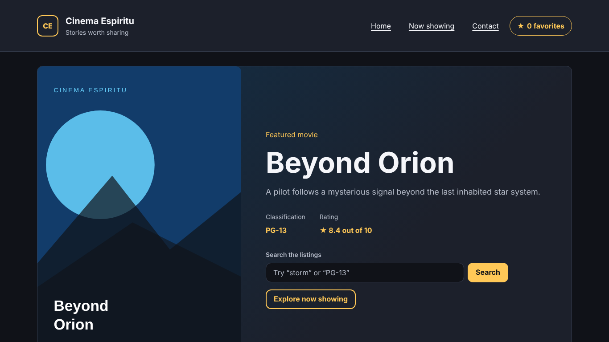

### 3.3. Estado de favoritas en App

```jsx
const [favoriteIds, setFavoriteIds] = useState(readStoredFavorites)

function toggleFavorite(movieId) {
  setFavoriteIds((currentIds) =>
    currentIds.includes(movieId)
      ? currentIds.filter((id) => id !== movieId)
      : [...currentIds, movieId],
  )
}
```

`toggleFavorite` agrega o quita una película. Usa la forma funcional de `setFavoriteIds` y crea un arreglo nuevo en vez de modificar el anterior.

### 3.4. Botón de favorita en MovieCard

```jsx
// App → MovieList → MovieCard
<MovieCard
  key={movie.id}
  movie={movie}
  isFavorite={favoriteIds.includes(movie.id)}
  onToggleFavorite={onToggleFavorite}
/>

// MovieCard
<Button
  variant={isFavorite ? 'primary' : 'ghost'}
  aria-pressed={isFavorite}
  onClick={() => onToggleFavorite(id)}
>
  <span aria-hidden="true">{isFavorite ? '★' : '☆'}</span>
  {isFavorite ? 'Favorite' : 'Add to favorites'}
</Button>
```

La tarjeta no guarda estado propio: avisa al padre con la función recibida y muestra lo que el padre le dice con `isFavorite`. El contador del Header se actualiza al instante y sin recargar.

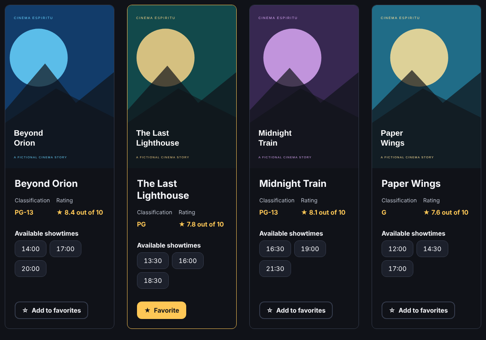


### 3.5. MovieSearch como entrada controlada

```jsx
function MovieSearch({ value, onChange, onSubmit }) {
  function handleChange(event) {
    console.log(`[MovieSearch] keystroke: "${event.target.value}"`)
    onChange(event.target.value)
  }

  function handleSubmit(event) {
    event.preventDefault()
    onSubmit()
  }

  return (
    <form className="movie-search" role="search" onSubmit={handleSubmit}>
      <label className="form-label" htmlFor={inputId}>Search the listings</label>
      <input className="form-input" id={inputId} type="search" value={value} onChange={handleChange} />
      <Button type="submit">Search</Button>
    </form>
  )
}
```

El valor del campo viene del estado (`value={searchText}`) y `onChange` lo actualiza con cada pulsación. El texto vive en `App` porque también lo necesita `MovieList`.

### 3.6. Retardo (debounce)

```jsx
// hooks/useDebounce.js
function useDebounce(value, delay) {
  const [debouncedValue, setDebouncedValue] = useState(value)

  useEffect(() => {
    const timerId = setTimeout(() => setDebouncedValue(value), delay)
    return () => clearTimeout(timerId)
  }, [value, delay])

  return debouncedValue
}

// App.jsx
const searchTerm = useDebounce(searchText, 400)
```

Cada pulsación reinicia el temporizador. El filtrado solo usa el texto cuando el usuario deja de escribir 400 ms. Diferencia en la consola al escribir "storm":

```text
[MovieSearch] keystroke: "s"
[MovieSearch] keystroke: "st"
[MovieSearch] keystroke: "sto"
[MovieSearch] keystroke: "stor"
[MovieSearch] keystroke: "storm"
[App] filtering listings by: "storm"
```

Hay cinco pulsaciones y un solo filtrado.

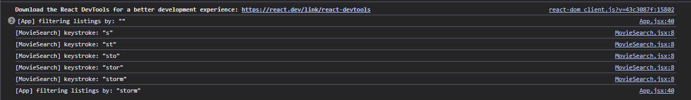

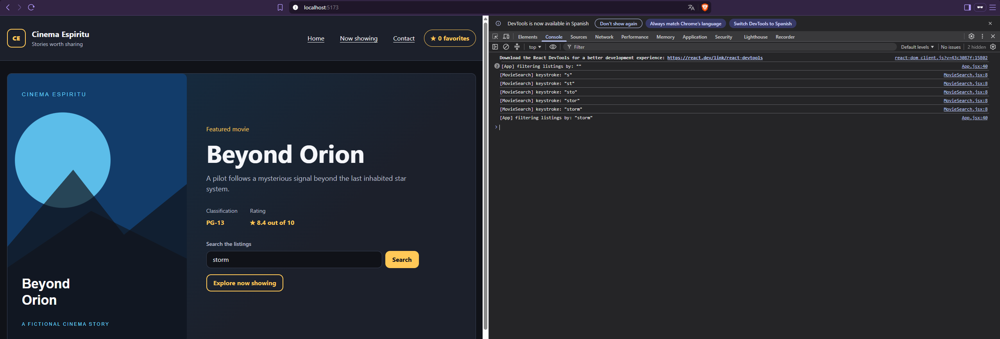

### 3.7. Filtrado y estado vacío en MovieList

```jsx
const visibleMovies = movies.filter((movie) => matchesSearch(movie, searchTerm))

{visibleMovies.length > 0 ? (
  <div className="movie-grid">{/* MovieCard por película */}</div>
) : (
  <div className="empty-state" role="status">
    <h3>No movies match “{searchTerm.trim()}”</h3>
    <Button variant="secondary" onClick={onClearSearch}>Clear search</Button>
  </div>
)}
```

La búsqueda compara el título, la sinopsis y la clasificación, sin distinguir mayúsculas ni tildes. Las películas visibles no se guardan en estado: se calculan en cada render.

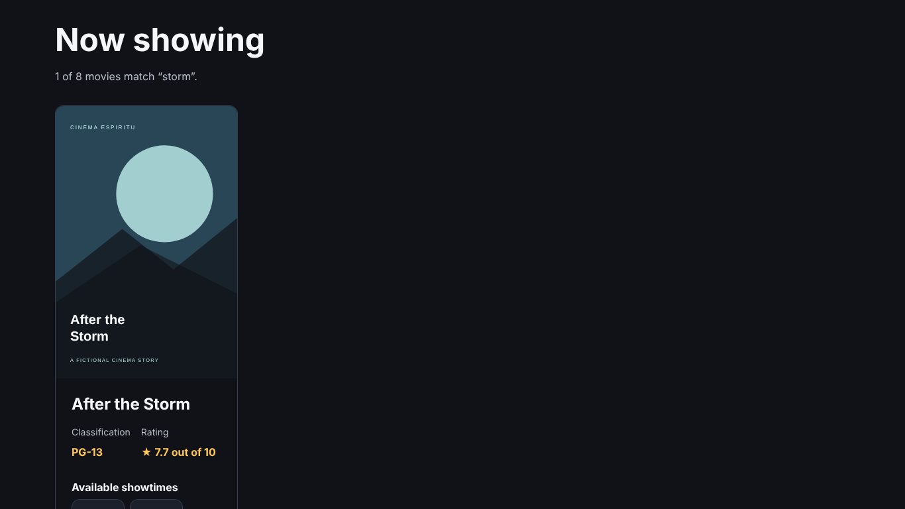

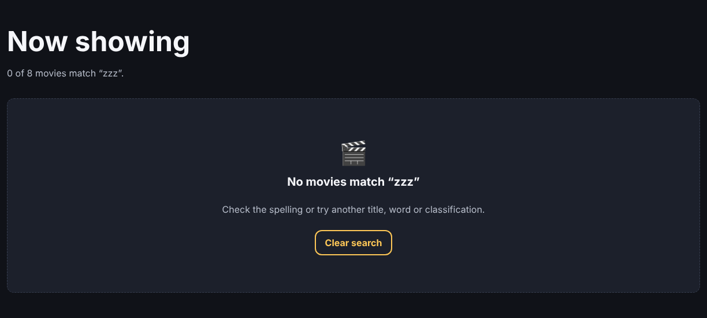

### 3.8. Buscador integrado en el banner

```jsx
<Hero movie={featuredMovie}>
  <MovieSearch value={searchText} onChange={setSearchText} onSubmit={showResults} />
</Hero>
```

`Hero` recibe el buscador por `children` y lo dibuja junto a su llamada a la acción. Al escribir en el banner la cartelera se filtra. El botón Search lleva a los resultados (`#now-showing`).

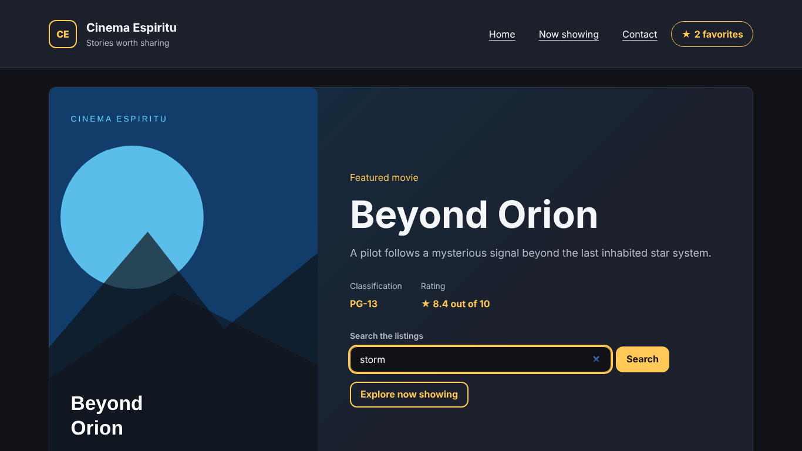

### 3.9. Favoritas en el almacenamiento del navegador

```jsx
const FAVORITES_STORAGE_KEY = 'cinema-espiritu:favorites'

function readStoredFavorites() {
  try {
    const storedValue = JSON.parse(localStorage.getItem(FAVORITES_STORAGE_KEY))
    return Array.isArray(storedValue) ? storedValue.filter((id) => typeof id === 'string') : []
  } catch {
    return []
  }
}

useEffect(() => {
  try {
    localStorage.setItem(FAVORITES_STORAGE_KEY, JSON.stringify(favoriteIds))
  } catch {
    // Storage may be unavailable; favorites still work in memory.
  }
}, [favoriteIds])
```

`useState(readStoredFavorites)` lee las favoritas solo al iniciar. `useEffect` las guarda cada vez que cambian. Si el valor guardado está dañado o el almacenamiento no está disponible, la app sigue funcionando.

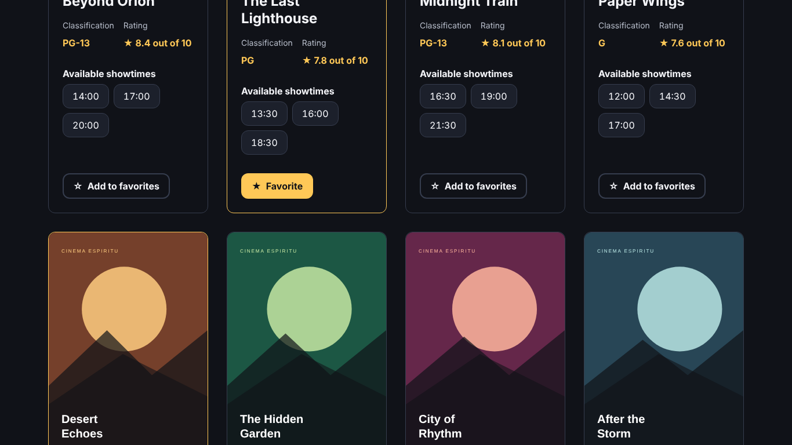

### 3.10. Dónde vive cada dato y por qué

| Dato | Componente | Por qué |
| --- | --- | --- |
| Favoritas (`favoriteIds`) | `App` (`useState`) | Las usan el Header y todas las tarjetas: va en su padre común. Las tarjetas solo avisan con `onToggleFavorite`. |
| Favoritas guardadas | `localStorage` desde `App` | Deben sobrevivir a una recarga. |
| Texto escrito (`searchText`) | `App` (`useState`) | Se escribe en `MovieSearch` (dentro de `Hero`), pero lo usa `MovieList` y lo borra el estado vacío. |
| Texto con retardo (`searchTerm`) | `useDebounce` en `App` | Evita filtrar con cada letra. |
| Películas visibles | Ninguno: se calculan en `MovieList` | Se derivan de `movies` y `searchTerm`; guardarlas sería duplicar estado. |
| Si una tarjeta es favorita | Ninguno: `favoriteIds.includes(id)` | Se deriva de las favoritas. |

El texto de búsqueda no se guarda en el navegador porque es temporal.

## 4. Casos de prueba

| N.º | Prueba | Resultado esperado | Obtenido |
| --- | --- | --- | --- |
| P01 | Clic en "Add to favorites" | Cambia a "★ Favorite" y el contador sube | Correcto |
| P02 | Clic otra vez | Vuelve a "☆ Add to favorites" y el contador baja | Correcto |
| P03 | Marcar 2 favoritas y recargar | Siguen marcadas; contador en 2 | Correcto |
| P04 | Enter o espacio sobre el botón con teclado | Cambia la favorita | Correcto |
| P05 | Escribir "storm" | 5 pulsaciones en consola, 1 filtrado; 1 película | Correcto |
| P06 | Buscar "pg-13" | 4 películas | 4 |
| P07 | Buscar "zzz" | Estado vacío con "Clear search" | Correcto |
| P08 | Clic en "Clear search" | Campo vacío y 8 películas | Correcto |
| P09 | Pulsar Search | Va a la sección de resultados | Correcto |
| P10 | Vista a 390 px | Sin desplazamiento horizontal | Correcto |
| P11 | Consola del navegador | Sin errores ni advertencias | Correcto |
| P12 | `npm run build` y `npm run lint` | Sin errores | 25 módulos; 0 warnings y 0 errors |

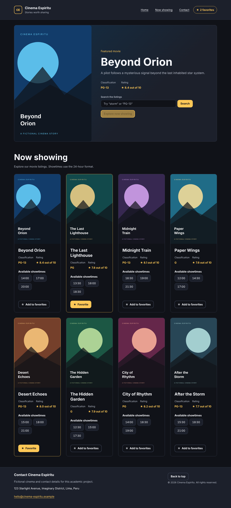

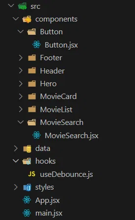

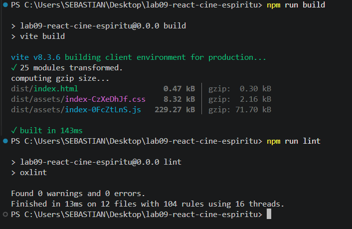

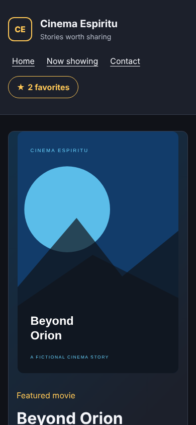

## 5. Observaciones

- `Button` es el componente reutilizable principal: el mismo código sirve en cinco lugares con tres variantes y como botón o como enlace, sin duplicarlo.
- `Hero` se volvió más reutilizable al recibir `children`: puede mostrar el buscador u otro contenido sin cambiar su código.
- El estado está solo donde hace falta. Lo que se puede calcular (películas visibles, si una tarjeta es favorita) no se guarda en estado.
- Ningún hijo modifica el estado de otro: todos avisan al padre con funciones (`onToggleFavorite`, `onChange`, `onSubmit`, `onClearSearch`).
- No se modifica el DOM a mano; la interfaz cambia solo por el estado.
- El retardo se separó en el hook `useDebounce`, que sigue la norma del prefijo `use`.

## 6. Conclusiones

1. Un componente que recibe su contenido por `children` y su aspecto por una prop de variante se puede usar en muchos lugares sin copiar código, como `Button` en cinco partes de la app.
2. `useState` hace que la interfaz responda a los eventos sin recargar: al cambiar el estado, React vuelve a dibujar solo lo necesario.
3. El estado debe vivir en el componente padre común de quienes lo usan. Por eso las favoritas y la búsqueda están en `App`, y lo que se puede calcular no se guarda en estado.
4. Pasar funciones del padre al hijo permite que el hijo avise de un evento sin tocar un estado que no es suyo.
5. Un retardo en el buscador evita trabajo innecesario, y `localStorage` hace que los datos del usuario sobrevivan a una recarga.
