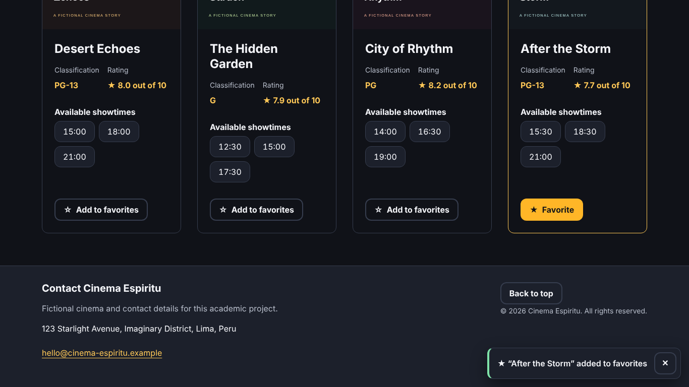
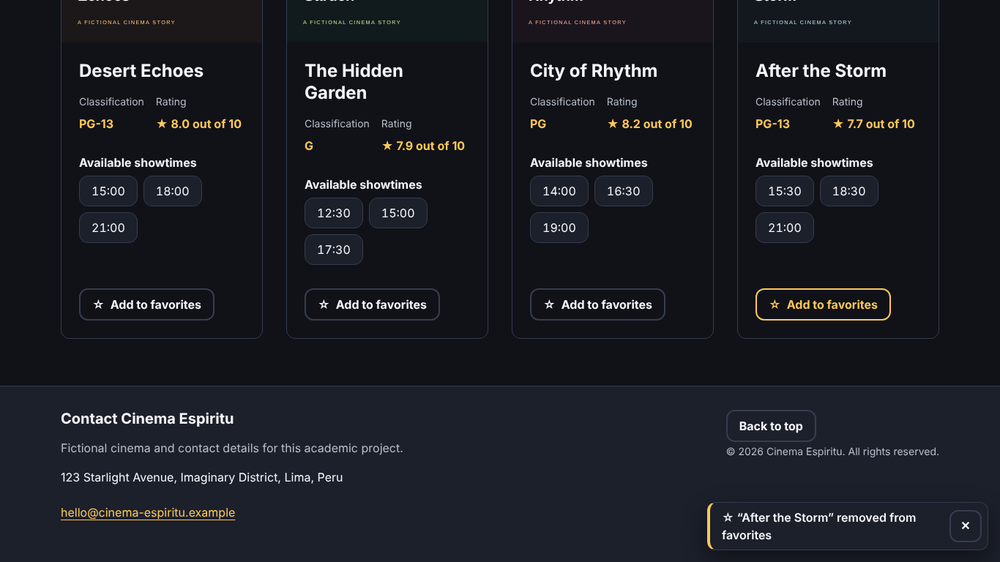
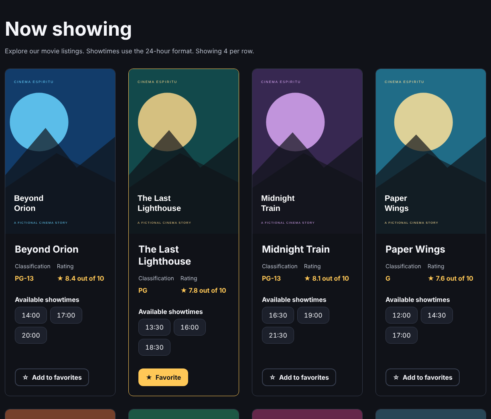
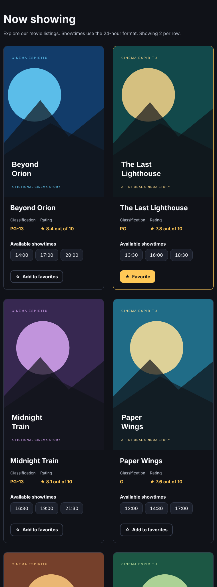
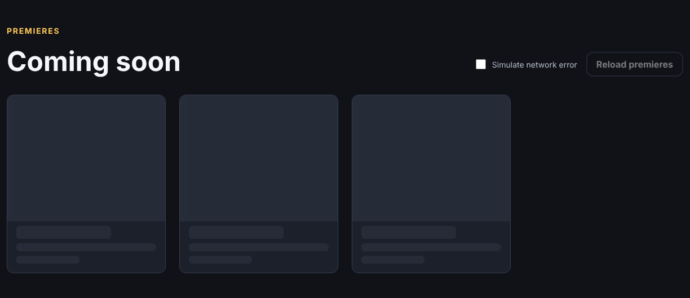
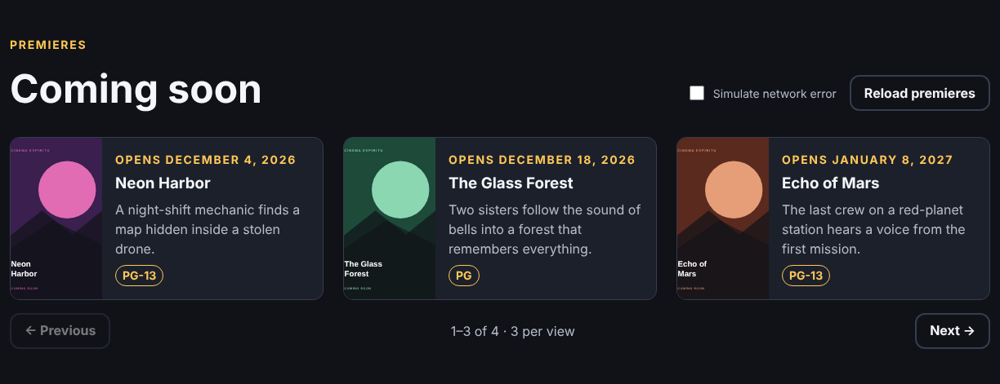
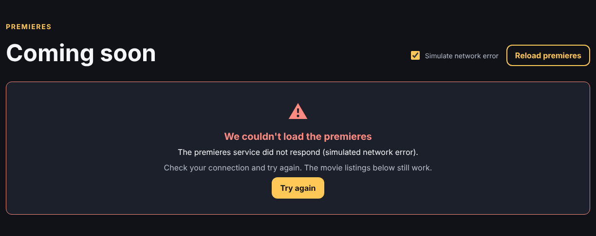
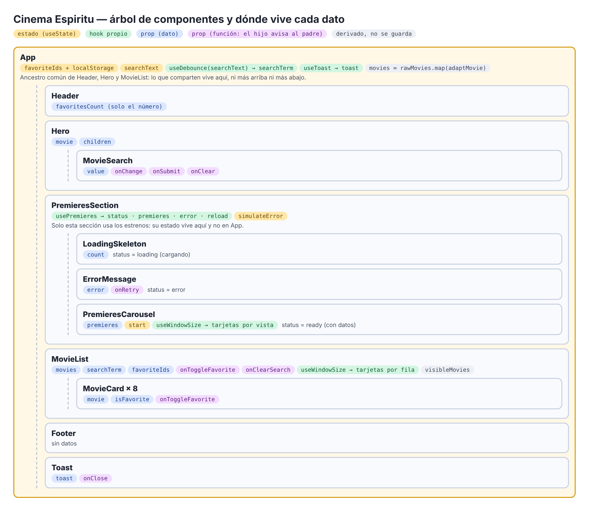
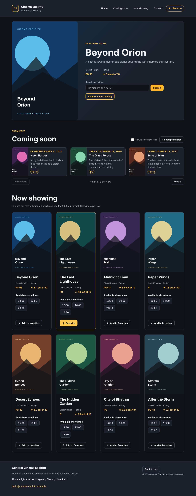

# Informe — Laboratorio 11: Comunicación entre componentes en ReactJS

## 1. Datos generales

| Campo | Información |
| --- | --- |
| Curso | Desarrollo de Aplicaciones Empresariales |
| Sección | 4-C24-B |
| Docente | Michael Montgomery Rosell |
| Alumno | Sebastián Espíritu |
| Proyecto | Cinema Espiritu (continuación del Lab 10) |
| Repositorio | https://github.com/SebastianEspiritu/lab09-react-cine-espiritu (rama `lab11`) |

## 2. Capacidades trabajadas

- Comunicar componentes hermanos elevando el estado al ancestro común.
- Extraer a hooks propios la lógica con estado que se repite entre componentes.

## 3. Desarrollo

Todos los desarrollos fueron realizados por **Sebastián Espíritu**.

### 3.1. Punto de partida, rama y estilos

Se partió del proyecto del Lab 10 funcionando y se creó la rama `lab11`:

```powershell
git checkout -b lab11
```

La hoja de estilos se amplió con `typography.css` (escala de títulos, etiquetas de sección y texto pequeño), nuevas utilidades en `utilities.css` (`stack`, `cluster`, `text-center`) y nuevas variables (colores del esqueleto y de éxito, sombra y separación del carrusel). También se añadieron `premieres.css` y `toast.css`. Los componentes anteriores se revisaron y se siguen viendo bien.

### 3.2. Patrón adaptador

```js
function adaptMovie(raw) {
  return {
    id: String(raw.movie_id),
    title: raw.name?.trim() || 'Untitled movie',
    image: raw.poster_file ? `${POSTER_FOLDER}${raw.poster_file}` : FALLBACK_POSTER,
    synopsis: raw.overview?.trim() || 'Synopsis coming soon.',
    classification: raw.age_rating || 'NR',
    rating: toRating(raw.score),          // 84 → 8.4
    showtimes: toShowtimes(raw.show_times), // '21:30 19:00' → ['19:00', '21:30']
    releaseDate: raw.release_date ?? null,
  }
}

// App.jsx
const movies = rawMovies.map(adaptMovie)
```

Los datos están en el formato de una API (`movie_id`, `name`, `score` de 0 a 100, horarios como texto). El adaptador los traduce al modelo de la app, ordena los horarios, descarta horas mal escritas y pone valores por defecto. La cartelera y los estrenos pasan por el mismo adaptador. Si mañana cambia la API, solo se toca `adaptMovie.js`.

**Prueba:** en `movies.js`, Midnight Train tiene los horarios desordenados (`21:30 19:00 16:30`); la tarjeta los muestra ordenados (16:30, 19:00, 21:30). Los `score` 84, 78… aparecen como 8.4, 7.8…

### 3.3. Aviso emergente al marcar y desmarcar favoritas

```jsx
// App.jsx
const { toast, showToast, hideToast } = useToast(3000)

function toggleFavorite(movieId) {
  const movie = movies.find((item) => item.id === movieId)
  const wasFavorite = favoriteIds.includes(movieId)
  setFavoriteIds((currentIds) =>
    currentIds.includes(movieId) ? currentIds.filter((id) => id !== movieId) : [...currentIds, movieId],
  )
  showToast(wasFavorite ? `☆ “${movie.title}” removed from favorites` : `★ “${movie.title}” added to favorites`)
}

// MovieCard.jsx: solo avisa
<Button onClick={() => onToggleFavorite(id)}>…</Button>
```

La tarjeta solo llama a `onToggleFavorite(id)`; no sabe que existe un aviso ni cómo se muestra. `App` actualiza las favoritas y pide el aviso. `useToast` lo oculta a los 3 segundos y cancela el temporizador si llega otro aviso antes.





### 3.4. Hook useDebounce en el buscador

```js
function useDebounce(value, delay) {
  const [debouncedValue, setDebouncedValue] = useState(value)
  useEffect(() => {
    const timerId = setTimeout(() => setDebouncedValue(value), delay)
    return () => clearTimeout(timerId)
  }, [value, delay])
  return debouncedValue
}
```

El retardo ya no se escribe a mano en el componente: está en el hook. Se usa en el buscador (`App`) y dentro de `useWindowSize`, así que también lo usan `MovieList` y `PremieresCarousel`.

### 3.5. Hook useWindowSize

```js
function useWindowSize(delay = 150) {
  const [size, setSize] = useState(readSize)
  useEffect(() => {
    function handleResize() { setSize(readSize()) }
    window.addEventListener('resize', handleResize)
    return () => window.removeEventListener('resize', handleResize)
  }, [])
  return useDebounce(size, delay)
}

// MovieList.jsx
const { width } = useWindowSize()
const columns = cardsPerRow(width) // 1, 2, 3 o 4
```

El hook escucha el cambio de tamaño, quita el listener al desmontar y aplica `useDebounce` para no redibujar con cada píxel. `MovieList` decide cuántas tarjetas van por fila y `PremieresCarousel`, cuántos estrenos se ven a la vez.

| Ancho | Tarjetas por fila | Estrenos por vista |
| --- | --- | --- |
| 1366 px | 4 | 3 |
| 1024 px | 3 | 3 |
| 768 px | 2 | 2 |
| 390 px | 1 | 1 |





### 3.6. Hook usePremieres: cargando, con datos y error

```js
function usePremieres() {
  const [request, setRequest] = useState(() => ({ id: 0, shouldFail: failRequestedInUrl() }))
  const [result, setResult] = useState({ status: 'loading', premieres: [], error: null })

  useEffect(() => {
    let isCurrent = true
    fetchPremieres({ shouldFail: request.shouldFail })
      .then((raw) => { if (isCurrent) setResult({ status: 'ready', premieres: raw.map(adaptMovie), error: null }) })
      .catch((error) => { if (isCurrent) setResult({ status: 'error', premieres: [], error }) })
    return () => { isCurrent = false }
  }, [request])

  function reload({ shouldFail = false } = {}) {
    setResult({ status: 'loading', premieres: [], error: null })
    setRequest((current) => ({ id: current.id + 1, shouldFail }))
  }

  return { ...result, reload }
}
```

`fetchPremieres()` simula una petición con 1,5 s de retardo que puede fallar a propósito. El hook devuelve el estado (`loading`, `ready` o `error`), los estrenos ya adaptados, el error y `reload()`. La variable `isCurrent` hace que se ignore una respuesta vieja si se recarga antes de que termine o si el componente se desmonta.

### 3.7. Esqueleto de carga y carrusel de estrenos

```jsx
function PremieresSection() {
  const { status, premieres, error, reload } = usePremieres()
  const [simulateError, setSimulateError] = useState(false)
  // …
  {status === 'loading' && <LoadingSkeleton count={3} label="Loading premieres" />}
  {status === 'error' && <ErrorMessage title="We couldn't load the premieres" error={error} onRetry={() => reload({ shouldFail: simulateError })} />}
  {status === 'ready' && <PremieresCarousel premieres={premieres} />}
}
```

Mientras carga se ven tarjetas grises animadas. La sección tiene `aria-busy="true"`, así que la pantalla nunca queda en blanco. Con datos aparece el carrusel con botones Previous y Next, que se desactivan en los extremos. Si falla, el mensaje explica qué pasó y ofrece **Try again**. La casilla **Simulate network error** y la dirección `?fail=1` permiten mostrar el error a propósito.







### 3.8. Contador de favoritas en la cabecera

```jsx
<Header favoritesCount={favoriteIds.length} />
```

Las favoritas viven en `App`. La cabecera recibe solo el número, no la lista completa.


### 3.9. Botón Clear en el banner

```jsx
// MovieSearch.jsx
{value !== '' && <Button variant="ghost" onClick={onClear} aria-label="Clear search">Clear</Button>}

// App.jsx
const debouncedSearch = useDebounce(searchText, SEARCH_DELAY_MS)
const searchTerm = searchText === '' ? '' : debouncedSearch // limpiar no espera el retardo
```

El botón aparece solo cuando hay texto. Al pulsarlo, `App` vacía `searchText`; el campo queda vacío y la cartelera vuelve a las 8 películas al instante. Así el buscador y el listado siguen sincronizados.


### 3.10. Árbol de componentes y dónde vive cada dato



| Dato | Dónde vive | Por qué |
| --- | --- | --- |
| Favoritas | `App` | Las usan `Header` y `MovieList`, que son hermanos. |
| Texto del buscador | `App` | Lo escribe `MovieSearch` (dentro de `Hero`) y lo usa `MovieList`, hermano de `Hero`. |
| Aviso | `App` (`useToast`) | Lo dispara el cambio de favoritas, que ocurre en `App`. |
| Estrenos y su estado | `PremieresSection` | Solo esa sección los usa; subirlos a `App` sería subir de más. |
| Simular error | `PremieresSection` | Solo la usa esa sección. |
| Posición del carrusel | `PremieresCarousel` | Solo la usa el carrusel. |
| Ancho de la ventana | Cada componente, con `useWindowSize` | Se comparte la lógica, no el dato. |
| Películas visibles | Ninguno: se calculan en `MovieList` | Se derivan de la búsqueda. |

**Por qué el contador de favoritas no puede vivir en la cabecera.** Las favoritas cambian cuando se pulsa el botón de una `MovieCard`, que está dentro de `MovieList`. `Header` y `MovieList` son hermanos, y en React los datos solo bajan de padre a hijo por props: un hermano no puede leer ni modificar el estado de otro. Si el contador viviera en `Header`, las tarjetas no tendrían cómo actualizarlo. La solución es elevar las favoritas a `App`, el ancestro común más cercano de ambos. `App` pasa a `MovieList` la lista y la función para cambiarla, y a `Header` solo el número, porque la cabecera no necesita más.

## 4. Casos de prueba

| N.º | Prueba | Resultado esperado | Obtenido |
| --- | --- | --- | --- |
| P01 | Abrir la página | Esqueleto de carga en Coming soon | Correcto |
| P02 | Esperar 1,5 s | Carrusel con 4 estrenos, 3 por vista | Correcto |
| P03 | Pulsar Next | 2–4 of 4; Next se desactiva | Correcto |
| P04 | Marcar Simulate network error y Reload premieres | Esqueleto y luego el mensaje de error | Correcto |
| P05 | Desmarcar y pulsar Try again | Vuelve el carrusel | Correcto |
| P06 | Abrir `?fail=1` | Mensaje de error | Correcto |
| P07 | Marcar una favorita | Aviso "added", contador +1 | Correcto |
| P08 | Desmarcarla | Aviso "removed", contador −1 | Correcto |
| P09 | Esperar 3 s | El aviso desaparece | Correcto |
| P10 | Ventana a 1366, 1024, 768 y 390 px | 4, 3, 2 y 1 tarjetas por fila | Correcto |
| P11 | Escribir "storm" y pulsar Clear | Campo vacío y 8 películas al instante | Correcto |
| P12 | Horarios de Midnight Train | Ordenados por el adaptador | Correcto |
| P13 | Consola del navegador | Sin errores | Correcto |



## 5. Observaciones

- **Lógica extraída a hooks y quién la comparte.** `useDebounce` (retardo) lo usan el buscador de `App` y `useWindowSize`. `useWindowSize` (tamaño de la ventana) lo usan `MovieList` y `PremieresCarousel`. `usePremieres` (petición con tres estados) lo usa `PremieresSection`. `useToast` (aviso temporal) lo usa `App`. Así los componentes quedan limpios y la lógica no se repite.
- **El estado sube solo lo necesario.** Favoritas, búsqueda y aviso suben a `App` porque los comparten hermanos. Los estrenos, la casilla de error y la posición del carrusel se quedan en su componente porque nadie más los usa.
- **Los hooks cumplen sus reglas.** Empiezan con `use`, se llaman siempre en el nivel superior del componente y limpian lo que crean: temporizadores, listeners y respuestas viejas.
- **El adaptador separa la API de la interfaz.** Los componentes nunca leen los nombres crudos de los datos.
- **La interfaz nunca queda en blanco.** Muestra el esqueleto mientras carga y un mensaje claro con opción de reintentar si falla. La cartelera sigue funcionando aunque fallen los estrenos.
- **Biblioteca de interfaz.** El laboratorio usa React, sin paquetes adicionales.

## 6. Conclusiones

1. Cuando dos componentes hermanos necesitan el mismo dato, este debe vivir en su ancestro común más cercano. Por eso las favoritas están en `App` y no en la cabecera.
2. El estado no debe subir más de lo necesario: los estrenos se quedan en su sección porque ningún otro componente los usa.
3. Los hooks propios permiten reutilizar lógica con estado sin repetir código. `useWindowSize` sirve tanto a la cartelera como al carrusel, y `useDebounce` al buscador y al tamaño de la ventana.
4. Una petición tiene tres estados (cargando, con datos y error), y la interfaz debe resolver cada uno para que el usuario siempre sepa qué está pasando.
5. El patrón adaptador aísla los datos externos: si cambia el formato de la API, solo se modifica una función y no los componentes.
