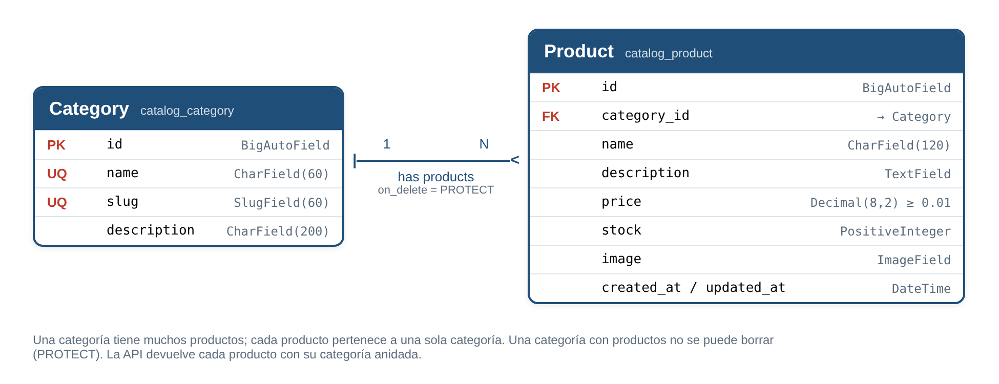

# Informe — Laboratorio 13: Estructura de comercio electrónico

| Campo | Información |
| --- | --- |
| Curso | Desarrollo de Aplicaciones Empresariales |
| Sección | 4-C24-B |
| Docente | Michael Montgomery Rosell |
| Alumno | Sebastián Espíritu |
| Proyecto | Cinema Espiritu: tienda del cine (continuación del Lab 12) |
| Repositorio | https://github.com/SebastianEspiritu/lab09-react-cine-espiritu (rama `lab13`) |

## 1. Qué se construyó

La app de cine suma una **tienda** con snacks, bebidas y merchandising:

- **Servidor:** nueva app `catalog` en Django con `Category` y `Product`, administrador con listados y filtros, serializadores anidados, `ViewSet` y router, filtro por categoría e imágenes.
- **Cliente:** capa `src/services/` (cliente de Axios, `productService`, `categoryService`, `movieService`), página del catálogo con filtro y tres estados, y formulario de alta y edición. El borrado se hace desde la tarjeta.

## 2. Diagrama del catálogo

Una categoría tiene muchos productos. `on_delete=PROTECT` impide borrar una categoría que todavía tiene productos; la API responde 409 en ese caso.

## 3. Tabla de la API

| Método | Dirección | Uso |
| --- | --- | --- |
| GET | `/api/products/` | Catálogo con la categoría anidada |
| GET | `/api/products/?category=<slug o id>` | Catálogo filtrado |
| GET | `/api/products/{id}/` | Un producto (formulario de edición) |
| POST | `/api/products/` | Alta (JSON, o multipart si lleva imagen) |
| PATCH | `/api/products/{id}/` | Edición |
| DELETE | `/api/products/{id}/` | Borrado |
| GET / POST | `/api/categories/` | Categorías con `product_count` / alta |
| GET / PATCH / DELETE | `/api/categories/{id}/` | Una categoría / edición / borrado (409 si tiene productos) |

## 4. Decisiones

- **Anidado de solo lectura + `category_id` para escribir:** al leer, el cliente recibe el objeto categoría completo; al escribir, solo manda el id. Así no se puede crear una categoría por accidente desde el formulario de producto.
- **`select_related('category')`:** el listado de N productos con su categoría es **una consulta SQL**, no N+1.
- **Un solo `DefaultRouter`** en `config/urls.py`: `/api/` lista `movies`, `categories` y `products`.
- **`apiRequest()`** es la única función que ejecuta peticiones. Los servicios solo dicen método, ruta y cuerpo, y los componentes reciben objetos ya adaptados (`price` como número, `imageUrl`, `category.name`).
- **El filtro vive en la URL** (`/shop?category=snacks`): se puede recargar o compartir.
- **`useResource()`** cancela con `AbortController` la petición de un filtro anterior, así una respuesta lenta no pisa a la nueva.

## 5. Casos de prueba

### Backend (`python manage.py test catalog`)

| Prueba | Resultado esperado |
| --- | --- |
| El listado trae la categoría anidada (id, nombre, slug, descripción) | OK |
| El listado completo usa 1 consulta SQL | OK |
| Filtro por id y por slug | OK |
| Categorías con `product_count` | OK |
| Alta con JSON y alta con imagen (multipart) | 201 |
| Alta inválida: nombre vacío, precio -1, stock -2, categoría inexistente | 400 con los 4 campos |
| Edición: precio y cambio de categoría | 200 |
| Borrado de producto | 204 |
| Borrado de categoría con productos | 409 |
| `seed_catalog` dos veces: no duplica, 3 categorías, 9 imágenes | OK |

### Frontend (manual)

| Caso | Resultado esperado |
| --- | --- |
| Entrar a Shop | Esqueleto y luego 9 tarjetas; chips All 9, Drinks 3, Merchandise 3, Snacks 3 |
| Pulsar Snacks | URL `?category=snacks`, 3 tarjetas, descripción de la categoría arriba |
| Add product sin datos | 400; mensajes bajo Name, Category y Price |
| Add product válido con imagen | Vuelve al catálogo; la tarjeta aparece con su imagen y un aviso |
| Edit: cambiar precio y categoría | Vuelve al catálogo con el precio y la categoría nuevos |
| Delete → Confirm | La tarjeta desaparece y los contadores se actualizan sin recargar |
| Django apagado | Recuadro de error con Try again (no pantalla en blanco) |

## 6. Observaciones

- **Cómo levantar:** ver el README → *Lab 13* (dos terminales: `runserver` y `npm run dev`).
- **Reparto:** el servidor guarda, valida y expone; el cliente solo pinta y habla con la API por `src/services/`.
- Las imágenes se guardan en `backend/media/` (no se suben a Git); `seed_catalog` las genera de nuevo.
- Los productos también se pueden cargar desde `http://127.0.0.1:8000/admin/` con un superusuario.

## 7. Conclusiones

1. Separar el proyecto en servidor (Django) y cliente (React), con una app de Django por responsabilidad, permite que cada parte crezca sin romper la otra.
2. Anidar la categoría en el serializador del producto entrega en una sola petición todo lo que la tarjeta necesita, y `select_related` evita el problema de N+1 consultas.
3. Una capa de servicios concentra URLs, Axios y manejo de errores: los componentes solo piden datos y, si cambia la API, se toca un solo lugar.
4. Cargar las categorías desde la API, y no escribirlas en el código, mantiene el filtro y el formulario sincronizados con lo que hay en la base de datos.
